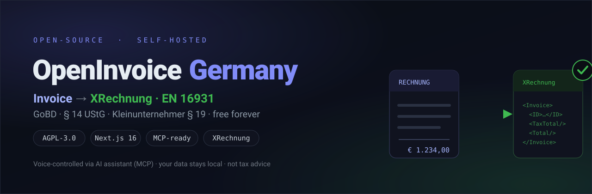
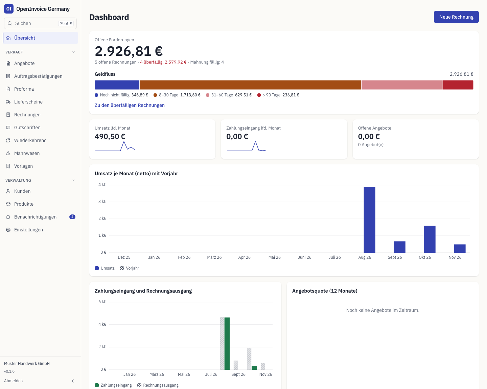
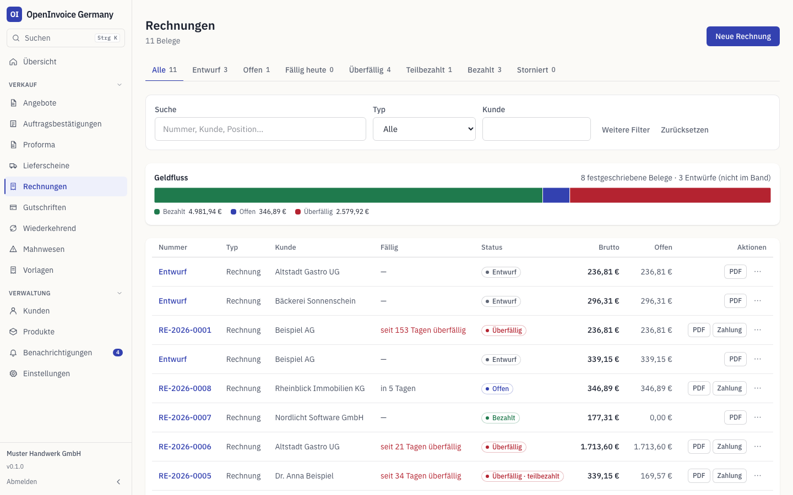
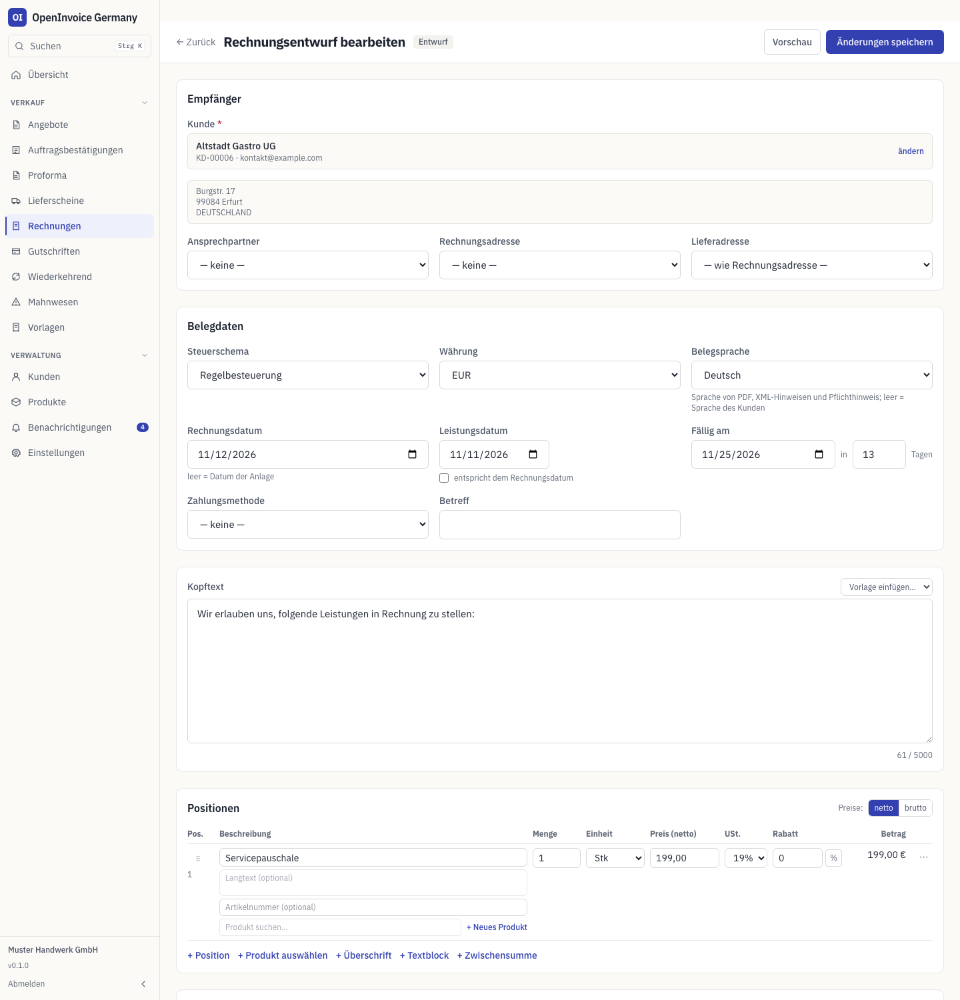
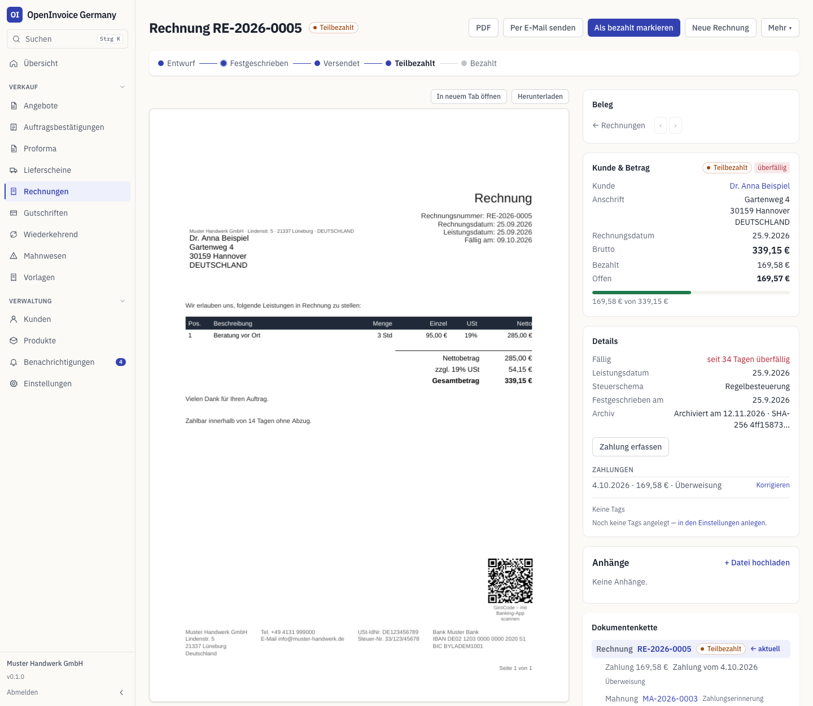
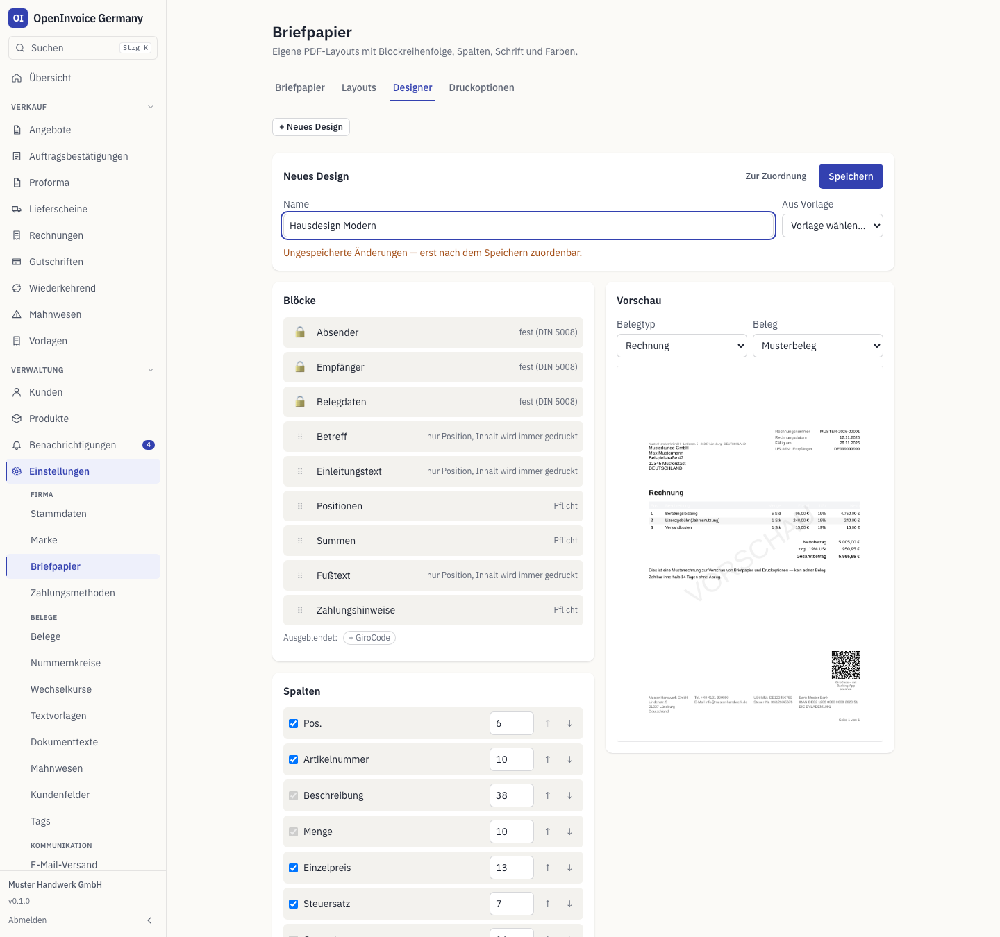
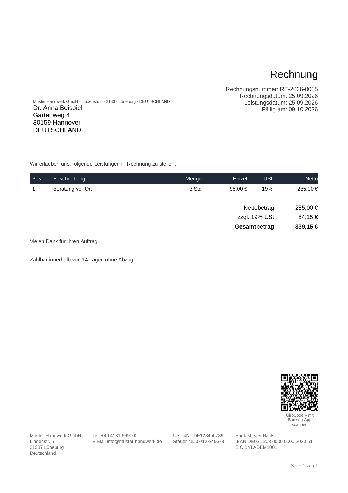
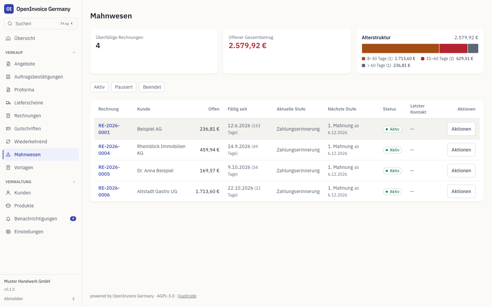
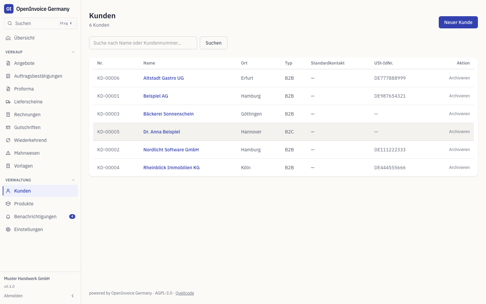

<div align="center">



# OpenInvoice Germany

**Kostenlose, self-hostbare Open-Source-Rechnungssoftware für Deutschland.**
E-Rechnung (XRechnung / ZUGFeRD) · GoBD · § 14 UStG · Kleinunternehmer § 19 · DSGVO

[](https://github.com/c-sakel/open-invoice-germany/actions/workflows/ci.yml)
&nbsp;·&nbsp; Lizenz: **AGPL-3.0** &nbsp;·&nbsp; [English](README.md) · **Deutsch**

</div>

> **Warum?** Ab 2025 gilt die E-Rechnungs-Empfangspflicht im B2B, ab 2027/2028 die Versandpflicht. Viele Selbstständige und KMU zahlen monatlich für Rechnungssoftware, nur um rechtskonform zu bleiben. Dieses Projekt macht das **kostenlos und frei** — du hostest es selbst, deine Daten bleiben bei dir.

> ⚠️ **Keine Steuer- oder Rechtsberatung.** GoBD-Konformität erfordert zusätzlich eine Verfahrensdokumentation des Anwenders. Alle rechtlichen Grundlagen mit Quellen stehen in **[COMPLIANCE.md](COMPLIANCE.md)** (Single Source of Truth). Ohne Gewähr.

---

## 📸 Einblicke

| | |
|---|---|
|  |  |
| **Übersicht** — offene Forderungen, Fälligkeiten, Umsatz | **Rechnungen** — Status-Tabs, Filter, Zahlung erfassen |
|  |  |
| **Editor** — Positionen, Rabatte, Live-Summen | **Belegansicht** — PDF, Zahlungen, Archiv, Dokumentenkette |
|  |  |
| **Layout-Designer** — Blöcke, Spalten, Live-Vorschau | **PDF** — DIN 5008, GiroCode, ZUGFeRD/PDF/A-3 |
|  |  |
| **Mahnwesen** — Altersstruktur, Mahnstufen | **Kunden** — Stammdaten, B2B/B2C |

Alle Daten in den Bildern sind fiktiv.

## 🗣️ Per Sprache mit einem KI-Assistenten (MCP)

Verbinde deine lokale Instanz mit einem **MCP-fähigen KI-Assistenten** und erstelle rechtssichere Rechnungen, indem du sie einfach beschreibst:

> „Erstelle eine Rechnung an Müller GmbH über 3 Stunden Beratung à 95 €, Leistung heute, schreib sie fest und exportier die XRechnung."

Der Assistent ruft die passenden Tools auf (Kunde/Leistung anlegen → Rechnung → festschreiben → PDF + XRechnung). Das Festschreiben **erzwingt** die § 14-Pflichtangaben — nicht-konforme Rechnungen sind ausgeschlossen. Die Rechnung wird lokal erstellt und gespeichert. Setup + Beispiele: **[docs/MCP.md](docs/MCP.md)**.

```bash
npm run mcp   # MCP-Server (stdio) starten / im MCP-Client registrieren
```

> 🔒 **Datenschutz (DSGVO).** Der App-Kern läuft **zu 100 % lokal**, das MCP-Feature ist aber optional und **nicht automatisch DSGVO-konform**: Sobald ein **Cloud-LLM** die Rechnung erstellt, werden die beschriebenen Inhalte (Kundenname, Leistungen, Beträge = personenbezogene Daten) an den Anbieter übermittelt und in deinem Auftrag verarbeitet (Auftragsverarbeitung, Art. 28 DSGVO). Für den geschäftlichen Einsatz mit echten Personendaten entweder ein **lokales Modell** nutzen (der MCP-Server ist anbieterneutral) oder einen **API-Zugang mit AVV** — Consumer-Chat-Abos haben in der Regel **keinen AVV**. Den Anbieter als Sub-Auftragsverarbeiter im Verarbeitungsverzeichnis und in der Datenschutzerklärung führen. Details: **[docs/MCP.md](docs/MCP.md)**. Keine Rechtsberatung.

## REST-API (`/api/v1`)

Unter `/api/v1` steht eine versionierte, per OpenAPI dokumentierte REST-API bereit — sie ruft dieselben Domain-Funktionen wie UI und MCP-Server auf (gleiche GoBD-Regeln, gleiche § 14-Pflichtangaben-Prüfung). Authentifizierung per API-Schlüssel je Organisation (Bearer-Token, Scopes `read`/`write`/`send`/`admin`), anlegbar unter **Einstellungen → API**.

```bash
curl -H "Authorization: Bearer oig_..." https://deine-instanz/api/v1/Invoice
```

Interaktive Doku (Swagger UI, Session-Login oder API-Schlüssel): `GET /api/docs`. Maschinenlesbare Spezifikation: `GET /api/v1/openapi.json`. Kompletter Ablauf mit curl-Beispielen (Kunde → Rechnung → festschreiben → PDF/XRechnung → Zahlung): **[docs/API.md](docs/API.md)**.

Ereignisgetriebene **Webhooks** (`/api/v1/Webhook`, Scope `admin`) liefern Ereignisse wie `invoice.finalized` oder `payment.recorded` an einen eigenen Endpunkt — HMAC-signiert, mit Retry/Backoff und einer SSRF-geschützten, nur-https-Outbox. Ereignisse, Payload-Form und Signaturprüfung mit Beispielcode (Node.js und PHP): **[docs/WEBHOOKS.md](docs/WEBHOOKS.md)**.

## Funktionen

- **Sprachsteuerung via MCP** (jeder MCP-fähige KI-Assistent) — siehe oben.
- **GoBD-Kern**: Festschreibung (Entwurf → unveränderbar), lückenlose Nummernkreise, append-only Audit-**Hash-Chain**, Storno statt Löschung.
- **§ 14 UStG**: Pflichtangaben-Prüfung blockt das Festschreiben bei fehlenden Angaben.
- **Steuerschemata**: Regelbesteuerung (19/7/0), Kleinunternehmer (§ 19), Reverse Charge (§ 13b), ig. Lieferung, Differenzbesteuerung (§ 25a), Kleinbetrag (§ 33).
- **E-Rechnung**: **XRechnung** (UBL, EN 16931) **und ZUGFeRD/Factur-X-Hybrid-PDF** (eingebettetes EN-16931-CII in einem **PDF/A-3b**-Container), beide direkt in der App erzeugt und gegen die **offiziellen Schematron-Regeln** geprüft (SaxonJS, ohne Java) — in der CI zusätzlich mit KoSIT-Validator und veraPDF gegengeprüft. B2G: Die Leitweg-ID des Kunden geht als Käuferreferenz (BT-10) hinaus; eine abweichende Lieferanschrift landet in BG-13/BG-15.
- **GoBD-Betrieb**: write-once-Belegarchiv (PDF, CII und UBL im Stand der ersten Ausgabe), regelmäßige Prüfung der Hash-Kette mit Statusseite, Prüfer-Export für die Betriebsprüfung (GDPdU/Z3-Datenzugriff inkl. amtlicher DTD), Gegenbuchung statt Löschen von Zahlungen, Vorlagen für Sicherungsskripte.
- **Auslandskunden**: Rechnungen in Fremdwährung mit Umrechnungskurs nach § 16 Abs. 6 UStG (USt in EUR ausgewiesen), Belegsprache Deutsch oder Englisch und OSS-Schwellenwächter (§ 3c Abs. 4 UStG) mit Dashboard-Karte und Benachrichtigung.
- **Belegarten**: Angebote, Auftragsbestätigungen, Proforma — in eine Rechnung umwandelbar.
- **Rabatte, Aufschläge & Skonto**: Positionsrabatt (Prozent + Festbetrag) und Belegrabatt/-aufschlag (anteilig je Steuersatz verteilt), korrekt als `AllowanceCharge` in XRechnung/ZUGFeRD (BG-20/21/27/28); Skonto (bis zu zwei Stufen) als BT-20-Text inkl. der Konvention `#SKONTO#TAGE=n#PROZENT=x.xx#`, mit Vorschlag beim Zahlungseingang.
- **Zahlungsmethoden**: Katalog je Organisation (Systemcodes + eigene), optionaler Kunden-Standard, beim Festschreiben eingefroren, als UNTDID-4461-`PaymentMeansCode` ausgegeben.
- **Teil-, Abschlags- und Schlussrechnungen** (§ 14 Abs. 5 UStG): Teilrechnung über Prozent/Betrag/einzelne Positionen aus Angebot oder Lieferschein, Abschlagsrechnung vor Leistungserbringung (E-Rechnung-Typcode 386), abschließende Schlussrechnung, die die Abschläge samt Steuer automatisch absetzt (unveränderlicher Abzugs-Snapshot, BT-113/BT-115/BG-3 in der E-Rechnung, passender PDF-Abzugsblock).
- **Ein Editor für alle Belege mit Live-Vorschau**: Rechnungen, Angebote/AB/Proforma und Lieferscheine im selben Editor, Kunden und Produkte direkt anlegen, PDF-Vorschau des ungespeicherten Entwurfs per Klick (mit Wasserzeichen, nichts wird gespeichert), Positionen per Drag-and-Drop oder Tastatur (`Alt+↑`/`Alt+↓`, `Enter` für neue Zeile) umordnen, Überschriften/Textblöcke/berechnete Zwischensummen neben regulären Positionen (nur reguläre Positionen landen im E-Rechnung-XML), Rich-Text (eingeschränktes Markdown — fett/kursiv/unterstrichen, eine Listenebene, Links) in Positionsbeschreibungen, Artikelnummern sowie Kopffelder (Betreff, Bestellnummer, interne Referenz, Ansprechpartner, Liefer-/Rechnungsadresse).
- **Beleganhänge**: Dateien an jeden Beleg (Rechnung, Angebot, Lieferschein, Mahnung, Abo) anhängen — 10 MB je Datei, 50 MB je Beleg, MIME-Whitelist + Magic-Bytes-Prüfung, hash-adressierte Ablage mit Dedup, auswählbar als Zusatzanhang beim Mailversand.
- **Zahlungen & Mahnwesen**: (Teil-)Zahlungen erfassen; gestufte Erinnerungen (Zahlungserinnerung → 1./2. Mahnung) mit **Verzugszinsen** (§ 288 BGB, taggenau auch über Basiszinswechsel; Basiszins-Halbjahrestabelle pflegbar in UI/REST/MCP) + 40-€-Pauschale (B2B), jeweils als PDF.
- **Abo-Rechnungen**: wöchentliche bis jährliche Vorlagen mit Abrechnungszeitraum, optional automatisch festschreiben, Lauf über UI/MCP oder Cron (`npm run recurring:run`). Abo-Positionen können Überschrift-/Text-/Zwischensummen-Blöcke enthalten; Positionen nach Verbrauch werden aus erfassten Verbrauchsmengen abgerechnet (UI/REST/MCP, mit `externalId`), der Lauf erfolgt erst nach Ende des Abrechnungszeitraums.
- **Gutschriften**: Vollstorno **oder** Teilgutschrift, das Original bleibt festgeschrieben.
- **Briefpapier, Druckoptionen & Nummernkreise**: Briefpapier je Organisation (Logo, Farbe, Ränder, Absender-/Fußzeile) mit Live-Vorschau; zehn globale Druckschalter (Fußzeile, Seitenzahlen, Falz-/Lochmarken, welche Spalten erscheinen) mit Beleg-Override im Entwurf; neun konfigurierbare Nummernkreise (Angebote, Auftragsbestätigungen, Proforma, Lieferscheine, Rechnungen, Gutschriften, Mahnungen sowie Kunden-/Artikelnummern) mit Muster/Präfix/Reset und Rückdreh-Sperre.
- **PDF-Layouts & Layout-Designer**: sieben feste Layouts (Standard, Schlicht, Klassik, Modern, Blau, Schwarz, Kompakt) nach DIN 5008 Form B, dazu ein **Layout-Designer** für eigene, versionierte Designs (Blockreihenfolge, Spalten, Schriften IBM Plex / Source Serif 4 / Inter) mit Live-Vorschau. Wählbar je Belegart, im Entwurf je Beleg überschreibbar; beim Festschreiben wird das Layout eingefroren. Die Fußzeile entsteht aus den Firmendaten (vier Spalten) oder aus drei eigenen Textfeldern.
- **EPC-QR-Code („GiroCode")** auf Rechnungen — Scannen & Bezahlen in jeder Banking-App, aus denselben IBAN-/Betragsdaten der Rechnung erzeugt; entfällt ohne Fehler, wenn eine Voraussetzung fehlt (Fremdwährung, keine IBAN, kein offener Betrag).
- **Kundenkomfort**: mehrere Adressen (Rechnung/Lieferung/Sonstige) und Ansprechpartner je Kunde mit Standard-Kennzeichen und Beleg-Snapshot, zehn kundenspezifische Vorgaben (Standardwährung/-Rabatt, E-Mail/CC, Bestellreferenz, Liefer-/Zahlungsbedingungstext), organisationsweite benutzerdefinierte Kundenfelder (Text/Zahl/Datum/Ja-Nein/Auswahl) als `{{customField.<Schlüssel>}}`, „Letztes Dokument übernehmen" (Positionen/Texte/Bedingungen/Preise) beim Anlegen neuer Angebote/AB/Rechnungen.
- **Vorlagen & Tags**: wiederverwendbare Belegvorlagen, Textbausteine und Tags zum Filtern von Belegen.
- **Arbeitsablauf**: abgeleiteter Rechnungsstatus (fällig/überfällig, nie gespeichert) für alle Listen, Filter und das Dashboard; Schnellaktionen je Zeile (senden, Zahlung erfassen, nächste Mahnstufe, umwandeln, stornieren …) nur dort, wo sie zum Status passen; filter- und durchsuchbare Listen mit Status-Tabs; Zeitleiste je Beleg (Erstellung, Versand, Zahlungen, Mahnungen, Statuswechsel); Dashboard mit offenen/fälligen/überfälligen Posten, Altersstruktur und Umsatz; Kunden-Detailseite mit Kennzahlen; Benachrichtigungen in der App mit optionalem täglichem Mail-Digest; Befehlspalette (⌘K/Ctrl+K).
- **Auswertungen**: Diagramme zu Umsatz, Zahlungseingang, Zahlungsverhalten, Top-Produkten, Angebotsquote und wiederkehrendem Umsatz.
- **Belegansicht mit PDF im Mittelpunkt**: eingebettetes PDF, Statuskarte rechts (Kunde, Daten, Beträge, Zahlungen/Mahnungen), Aktionen oben, Belegkette, Blättern durch die zuletzt gefilterte Liste mit `‹`/`›` bzw. `Alt+←`/`Alt+→`.
- **Self-hosted**: SQLite-Solo ohne Server **oder** PostgreSQL via Docker.
- **Anmeldung**: eingebautes Admin-Konto (scrypt-Hash + signiertes Session-Cookie, gehärtete Anmeldung, Passwort ändern) — App und API geschützt. Optional Zwei-Faktor-Authentifizierung (TOTP mit Wiederherstellungscodes) und Passwort-Reset per Mail (benötigt SMTP und `APP_BASE_URL`). API-Anfragen werden protokolliert (geschwärzt) unter Einstellungen → API.
- **E-Rechnungs-Kennungen & USt-IdNr.-Prüfung**: Peppol-Endpunkt-IDs mit EAS-Schema (BT-34/BT-49) in UBL und CII, Prüfziffernprüfung der Leitweg-ID und optionale VIES-Prüfung der Kunden-USt-IdNr. (standardmäßig an, beim Festschreiben aus; jede Prüfung wird append-only gespeichert).
- **Karte und SEPA-Lastschrift in der E-Rechnung** (BG-18/BG-19): Karte nur mit den letzten vier Ziffern, Lastschrift mit Gläubiger-ID (Firma), Mandat (Kunde) und Vorabankündigung im PDF; bei unvollständigen Angaben fällt die Zahlungsart auf Überweisung mit Hinweis zurück.
- **Einzelpreise bis 0,00001 €**: Zeilennetto wird kaufmännisch gerundet, BT-146 trägt fünf Nachkommastellen. Brutto-Eingabe per REST/MCP.
- **CSV-Export & -Import**: Belege und Kontakte als CSV exportieren; Kontakte und Produkte mit Vorschau importieren, mit Formelschutz und 24-h-Sperre gegen Doppel-Import.
- **Sammel-Storno**: mehrere Rechnungen aus der Liste auf einmal stornieren (max. 50, je Beleg ein eigener Storno, Ergebnisbericht); auch per REST/MCP.
- **Optionale HTML-Mail**: wird zusätzlich zum Textteil gesendet, standardmäßig aus.
- **Postversand über LetterXpress** (standardmäßig aus, Trockenlauf, Bestätigung je Moduswechsel und je Beleg; Mahnautomatik nur mit ausdrücklicher Einstellung).
- **API-Erweiterungen**: `updatedSince` und Cursor-Paginierung in Listen, Anlegen + Festschreiben + Zahlung in einem Aufruf mit Pflicht-`Idempotency-Key` (24 h Wiedergabe), Sammel-Kontakte (max. 100), Sammel-Storno, Brutto-Eingabe.
- **Berliner Zeit**: Fälligkeiten, Skonto-Fristen, E-Rechnungs-Daten und Auswertungen nutzen den Berliner Kalendertag.

### Status

Seit September 2026 im produktiven Einsatz für echte Rechnungen. Alles oben Genannte funktioniert und ist durch Tests abgedeckt; die E-Rechnungen bestehen bei jedem CI-Lauf die offiziellen Validatoren. Bewusst nicht Teil des Projekts: DATEV-Export, Finanzbuchhaltung und Mehrbenutzer/Rollen. Die Software erzeugt keine ZM (§ 18a UStG) und keine OSS-Meldungen (§ 18j UStG). Siehe [docs/ARCHITEKTUR.md](docs/ARCHITEKTUR.md) und die ehrliche Liste der **[bekannten Einschränkungen](docs/LIMITATIONEN.md)**.

## Dokumentworkflow

Angebot → Auftragsbestätigung → Lieferschein → Rechnung, alles verknüpft:

1. **Angebot** anlegen (Entwurf, editierbar), versenden — Status `DRAFT → SENT`.
2. Auf `ACCEPTED` setzen (oder direkt in eine **Auftragsbestätigung** umwandeln).
3. In einen **Lieferschein** umwandeln (Mengen aus Angebot/AB, Überlieferung blockiert) und/oder in einen **Rechnungsentwurf**.
4. Jede Umwandlung wird als Dokumentverknüpfung gespeichert; die **Dokumentkette** (auf jeder Angebots-/Rechnungs-/Lieferschein-Seite sichtbar) zeigt die volle Historie — Angebot → AB → Lieferschein → Rechnung → Zahlungen/Mahnungen.
5. Der Abrechnungsstand (keine/teilweise/voll) wird aus diesen Verknüpfungen abgeleitet, nicht gespeichert.
6. Statt (oder zusätzlich zu) einer vollen Rechnung: **Teilrechnung** (Prozent/Betrag/einzelne Positionen) oder **Abschlagsrechnung** aus Angebot/AB, danach **Schlussrechnung** — Abschläge samt Steuer werden automatisch abgesetzt (§ 14 Abs. 5 UStG).

Dieselben Aktionen auch per MCP: `convert_document`, `create_delivery_note`, `set_document_status`, `duplicate_document`, `create_partial_invoice`, `create_downpayment_invoice`, `create_final_invoice`, `get_billing_state`. Details: [docs/ARCHITEKTUR.md](docs/ARCHITEKTUR.md), Einschränkungen: [docs/LIMITATIONEN.md](docs/LIMITATIONEN.md).

### Angebot online annehmen lassen

Auf der Angebots-Detailseite (`Dokumente → Angebot`) unter „Annahme-Link" einen Link erzeugen — die URL wird **einmalig** angezeigt (Kopieren-Button), danach nicht mehr abrufbar. Der Kunde öffnet den Link ohne Login, sieht Angebot + PDF-Download und kann annehmen oder ablehnen (Name Pflicht, E-Mail/Kommentar optional). Nach der Entscheidung: Status `ACCEPTED`/`REJECTED`, eine interne Benachrichtigungsmail, und je nach Einstellung (**Einstellungen → Dokumente**) automatisch eine Auftragsbestätigung oder ein Rechnungsentwurf. Der Link kann jederzeit widerrufen werden. Für den Platzhalter `{{offer.link}}` in der Angebots-Mailvorlage `APP_BASE_URL` setzen (`.env`) — sonst bleibt er leer.

### Navigation und Suche
Die Seitenleiste links gliedert die App in Übersicht, Verkauf (Angebote, Auftragsbestätigungen, Proforma-Rechnungen, Lieferscheine, Rechnungen, Gutschriften, Abo-Rechnungen, Mahnwesen) und Verwaltung (Kunden, Produkte, Benachrichtigungen, Einstellungen). Sie lässt sich auf Symbole einklappen. Das Suchfeld oben (auch ⌘K / Ctrl+K) findet Belege nach Nummer oder Kunde sowie Kunden und Produkte und bietet Schnellaktionen.

### Oberfläche
Alle Farben, Radien, Schatten und Schriften sind Design-Tokens im `@theme`-Block von `src/app/globals.css` (`paper`, `sheet`, `ink`, `pen`, `stamp`, `seal`, `ledger` …); Komponenten nutzen die Token-Klassen (`bg-sheet`, `text-ink-soft` …) statt fester Farben. Der Dunkelmodus folgt der Systemeinstellung (`prefers-color-scheme`), einen manuellen Schalter gibt es nicht. Die Schriften (IBM Plex Sans und Mono) liegen lokal über `@fontsource` (SIL OFL) bei — es geht keine Anfrage an einen externen Schriftdienst. Listen werden auf schmalen Bildschirmen als Karten dargestellt, Diagramme passen sich ihrem Container an, und der Tastaturfokus ist als 2-px-Rahmen sichtbar.

## Tech-Stack

Next.js 16 (App Router) · TypeScript (strict) · Prisma 6 · SQLite/PostgreSQL · TailwindCSS · Zod · Vitest.
Geldbeträge als Integer-Cent, Mengen als Integer-Milliunits, Steuer pro EN-16931-Gruppe — siehe [docs/ARCHITEKTUR.md](docs/ARCHITEKTUR.md).

## Schnellstart (Solo / SQLite — kein Server nötig)

```bash
git clone https://github.com/c-sakel/open-invoice-germany.git
cd open-invoice-germany
npm install
cp .env.example .env            # DATABASE_URL="file:./dev.db" ist Default
npm run db:migrate              # Schema anlegen
npm run db:seed                 # optionale Demo-Daten
npm run dev                     # http://localhost:3000
```

Die SQLite-Datei liegt unter `prisma/dev.db` und gehört nur dir. Beim ersten Start legst du unter **`/setup`** dein Admin-Konto an (nach `npm run db:seed` gibt es einen Demo-Login `admin@example.com` / `demo1234` — bitte ändern). Für **Produktion**: `AUTH_SECRET` in `.env` setzen (`openssl rand -base64 32`) und hinter HTTPS betreiben.

**Nativer Produktivbetrieb ohne Docker** (`npm run build && npm start`): `AUTH_SECRET` ist Pflicht — ohne startet die Sitzungssignierung nicht. Hinter einem TLS-Reverse-Proxy `X-Forwarded-Proto` weiterreichen (das Session-Cookie bekommt `Secure` nur bei HTTPS; reines HTTP im LAN funktioniert ebenfalls). Sendet der Proxy den Header nicht, `SESSION_COOKIE_SECURE=true` setzen.

**In der App:** `Einstellungen` (Unternehmen anlegen) → `Kunden` → `Neue Rechnung` → Position erfassen → **Festschreiben** (vergibt die Nummer, macht GoBD-konform unveränderbar) → **PDF**- und **XRechnung**-Export. Komplette Schritt-für-Schritt-Anleitung: **[docs/ANLEITUNG.md](docs/ANLEITUNG.md)**.

## Mit Docker (PostgreSQL)

Ab Version 1.0.1 erscheint zu jedem Release ein fertiges Image für `linux/amd64` und `linux/arm64`: **`ghcr.io/c-sakel/open-invoice-germany`** (Tags `1.0.1`, `1.0`, `1`, `latest`).

```bash
# .env neben docker-compose.yml anlegen (nie committen):
#   POSTGRES_PASSWORD=<openssl rand -hex 24>
#   AUTH_SECRET=<openssl rand -hex 32>
docker compose up -d            # lädt das Image; mit --build stattdessen aus diesem Checkout bauen
```

Danach `http://localhost:3000` öffnen und unter `/setup` das Konto anlegen. Die App lauscht nur auf `127.0.0.1` — für den Zugriff von außen einen TLS-Reverse-Proxy davorsetzen. `OIG_VERSION` in der `.env` legt eine Version fest (Standard `1`, also die neueste 1.x).

Das Image entsteht aus dem Standalone-Output von Next.js und enthält nur, was der Server zur Laufzeit braucht — keine Screenshots, Doku, Tests oder Entwicklungsabhängigkeiten (der Build-Kontext ist eine Whitelist in `.dockerignore`). Es läuft als unprivilegierter Benutzer `node` (UID 1000) mit `tini` als Init-Prozess — die Programmdateien gehören root, beschreibbar sind nur die Datenverzeichnisse; die Compose-Datei entzieht zusätzlich alle Linux-Capabilities. Migrationen laufen bei jedem Start (`prisma migrate deploy`).

Zwei benannte Volumes halten neben `oig-db` die Daten: `oig-attachments` (Beleganhänge, `ATTACHMENTS_DIR`) und `oig-archive` (write-once-Belegarchiv, `ARCHIVE_DIR`). Alle drei sichern.

**Update von einem Image vor 1.0.1** (lief als root): Die Volumes gehören noch root, der Container startet dann nicht und nennt den Befehl. Einmalig den Eigentümer umstellen:

```bash
docker compose run --rm --user root --cap-add CHOWN --cap-add DAC_READ_SEARCH \
  --entrypoint chown app -R node:node /app/data
```

**Bestehende Instanz aktualisieren.** Wurde die Datenbank mit einer älteren Version
per `prisma db push` angelegt, fehlt ihr die Migrationshistorie. Der Container
startet dann nicht, sondern nennt den einmalig nötigen Befehl. Vorher ein Backup
ziehen.

**`migrate resolve` nicht blind ausfuehren.** Die Baseline `0_init` bildet den
aktuellen Stand ab, inklusive `RecurringInvoice`, `RecurringInvoiceLine` und
`Invoice.recurringInvoiceId`. Eine ältere Bestandsinstanz kennt diese Tabellen und
Spalten unter Umständen nicht. Wird die Baseline ungeprüft als angewendet
markiert, glaubt Prisma, das Schema sei vollständig, und spätere Abfragen
scheitern mit `column ... does not exist`. Vorher prüfen:

```bash
docker compose run --rm app \
  npx prisma migrate diff --from-url "$DATABASE_URL" \
    --to-schema-datamodel prisma/schema.postgres.prisma --script
```

**Wichtig:** `--to-schema-datamodel` vergleicht gegen den aktuellen Modellstand
(Head), nicht gegen die Baseline `0_init`. Referenz für den Baseline-Stand ist
ausschließlich `prisma/migrations-postgres/0_init/migration.sql`. Der Diff kann
daher auch Tabellen oder Spalten zeigen, die erst in einer **späteren**
Migration unter `prisma/migrations-postgres/` eingeführt wurden (z. B. die
Snapshot-Spalten) — diese gehören **nicht** von Hand eingespielt,
sondern werden nach dem `resolve` automatisch von `migrate deploy` nachgezogen.
Ob eine Spalte/Tabelle zur Baseline gehört, zeigt
`grep -l "<spaltenname>" prisma/migrations-postgres/*/migration.sql`: taucht sie
nur in `0_init` auf, gehört sie zur Baseline; taucht sie (auch) in einer
späteren Migration auf, stammt sie von dort und wird nicht per Hand angelegt.

- **Ausgabe leer** (nur der Kommentar "This is an empty migration"): die
  Datenbank entspricht bereits der Baseline. `migrate resolve --applied 0_init`
  unten ist sicher.
- **Ausgabe enthält nur `CREATE TABLE` / `ALTER TABLE ... ADD COLUMN` /
  `CREATE INDEX` / `ALTER TABLE … ADD CONSTRAINT` (Fremdschlüssel)**: nur die
  Anweisungen einspielen, die zu `0_init` gehören (siehe `grep`-Regel oben);
  Anweisungen zu Spalten/Tabellen aus späteren Migrationen weglassen. Geprüftes
  SQL mit `docker compose run --rm app npx prisma db execute --url
  "$DATABASE_URL" --stdin` einspielen, danach mit `migrate resolve` fortfahren.
- **Ausgabe enthält irgendein `DROP`**: abbrechen. Nicht anwenden, kein
  `migrate resolve` ausführen. Die Datenbank enthält Daten, die die Baseline
  nicht kennt — vorher Rücksprache halten.

Ist der Diff sauber (oder wurde eingespielt):

```bash
docker compose run --rm app \
  npx prisma migrate resolve --config prisma.postgres.config.ts --applied 0_init
```

Danach startet der Container normal; künftige Schemaänderungen laufen über
`prisma migrate deploy`.

**Ist ein Migrationseintrag in `_prisma_migrations` als fehlgeschlagen markiert**,
verweigert `migrate deploy` die Ausführung und der Container startet nicht. Das
ist gewollt (fail-closed) statt bei unsicherem Schemazustand einfach
weiterzulaufen. Prüfen, was die Migration teilweise angerichtet hat, dann mit
`prisma migrate resolve --rolled-back <name>` auflösen.

`docker-compose.yml` startet App + PostgreSQL. XRechnung und ZUGFeRD erzeugt die App selbst, ein Zusatzdienst ist nicht nötig. Das Postgres-Schema liegt in `prisma/schema.postgres.prisma` (modellidentisch, nur andere Datasource).

## E-Mail-Versand einrichten

Nur SMTP — keine eingebaute Anbindung an Versanddienste per API (siehe [docs/ARCHITEKTUR.md](docs/ARCHITEKTUR.md)). Schritte:

1. Unter **Einstellungen → E-Mail-Versand** SMTP-Host, Port, Verschlüsselung, Zugangsdaten und Absenderadresse eintragen.
2. `AUTH_SECRET` (siehe `.env.example`) dient auch als Schlüssel für das gespeicherte SMTP-Passwort — vor der Mail-Einrichtung setzen und das Passwort nach einem Wechsel von `AUTH_SECRET` neu eintragen.
3. Mit **Testmail senden** die Einstellungen prüfen, bevor echte Belege verschickt werden.
4. Unter **Einstellungen → Vorlagen** die mitgelieferten Mailvorlagen (Betreff/Text/Signatur) je Belegart anpassen oder eigene anlegen; Platzhalter wie `{{document.number}}` listet der Editor auf.
5. Versendet wird derzeit nur als Text, ohne Zustell-/Bounce-Tracking (Status bleibt `SENT`) — alle Einschränkungen in [docs/LIMITATIONEN.md](docs/LIMITATIONEN.md).

## Tests

```bash
npm test          # Vitest: Money, Steuer, Nummernkreis, GoBD-Unveränderbarkeit, Hash-Chain, EN-16931
```

Die Integrationstests beweisen u. a. **lückenlose, unveränderbare Nummernkreise** und dass festgeschriebene Rechnungen nicht editierbar sind.

## E-Rechnung-Validierung

```bash
npm run validate:erechnung      # offizielle Schematron-Regeln, ohne Java
```
Prüft die erzeugte XRechnung gegen die **offiziellen Schematron-Regeln** in purem Node via SaxonJS:
- **EN-16931-UBL-Schematron** (ConnectingEurope) und
- **XRechnung-CIUS / BR-DE** (offizielle KoSIT-Konfiguration 3.0.2; benötigt `unzip`).

Das ist im Kern dieselbe Schematron-Prüfung wie der **[KoSIT-Validator](https://github.com/itplr-kosit/validator)** — und läuft als **harter Gate in der CI**. Der KoSIT-Validator (Java) läuft dort zusätzlich als unabhängiger Cross-Check (deckt auch die vorgelagerte XSD-Prüfung ab). Schnelle Kernregeln sind Teil von `npm test`.

## Mitmachen

Beiträge willkommen — siehe [CONTRIBUTING.md](CONTRIBUTING.md). Rechtliche Korrekturen bitte mit Quelle (Norm/BMF-Schreiben) gegen [COMPLIANCE.md](COMPLIANCE.md).

## Wartung

Weiterentwickelt und gepflegt von [sakel-it.de](https://sakel-it.de).
Entstanden aus dem Projekt OpenInvoice Germany der [AutomationsManufaktur](https://automationsmanufaktur.de) ([Original-Repository](https://github.com/automationsmanufaktur-labs/open-invoice-germany)); Lizenz und Urheberhinweise gelten unverändert weiter.

## Lizenz

**[AGPL-3.0](LICENSE).** Du darfst die Software nutzen, ändern und selbst hosten. Wer sie als Netzwerk-Dienst betreibt, muss den (modifizierten) Quellcode den Nutzern verfügbar machen — so bleibt das Projekt für alle frei. Begründung der Lizenzwahl: [docs/ARCHITEKTUR.md](docs/ARCHITEKTUR.md#4-lizenz-empfehlung).
